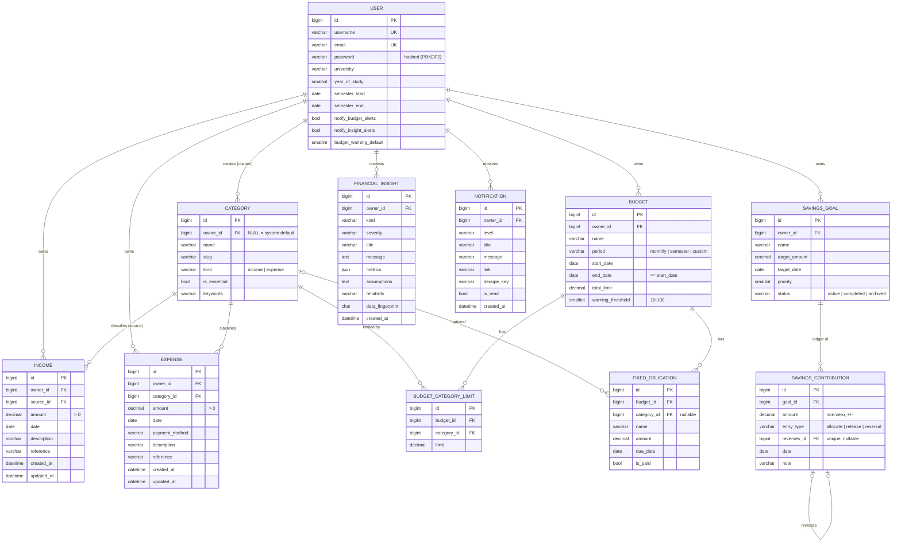

# Database design (Phase 2)

All money fields are `DECIMAL(12,2)` (Django `DecimalField`), never float. Every financial record is owned by exactly one user, directly (`owner_id`) or through its parent (budget or goal). Deleting a user cascades to all of their records.

## Entity-relationship diagram

## Constraints and indexes

| Table | Constraint / index | Why |
|---|---|---|
| user | unique `username`, unique `email` | one account per person |
| category | unique (`owner`, `kind`, `slug`); unique (`kind`, `slug`) where owner is NULL | no duplicate names per student or among defaults |
| income / expense | CHECK `amount > 0`; index (`owner`, `date`) | valid amounts; fast date-range queries per student |
| expense | index (`owner`, `category`) | fast category breakdowns |
| budget | CHECK `end_date >= start_date`; index (`owner`, `start_date`, `end_date`) | valid ranges; find active budgets quickly |
| budget_category_limit | unique (`budget`, `category`) | one limit per category per budget |
| savings_contribution | CHECK `amount <> 0`; unique `reverses_id` | no empty entries; an entry can be reversed only once |
| savings_goal | index (`owner`, `status`) | list active goals |
| insight / notification | index (`owner`, `created_at`), (`owner`, `is_read`) | recent insights; unread counts |

Category foreign keys use `ON DELETE PROTECT`, so a category in use cannot be deleted and silently orphan transactions.

> MySQL/MariaDB do not support conditional (partial) unique indexes. Django skips the "system category" unique constraint on MySQL; the same rule is enforced by the data migration and the category form.

## Design decisions and trade-offs

* **Custom user model from the first migration.** Django recommends this because switching later is very hard. It also lets us add semester dates and notification preferences without a separate profile table.
* **Separate Income and Expense tables** instead of one signed "transaction" table. Each has different fields (source vs category and payment method), and separate tables make totals impossible to mix up. The cost is a union in "recent activity", done in Python.
* **Categories as a table, not hard-coded choices.** Students can add their own, and keywords for the auto-categoriser live with the category.
* **Budget utilisation is calculated, not stored.** Spent amounts are summed from expenses at read time, so they are always correct after edits and deletions. With student-sized data this is fast thanks to the (`owner`, `date`) index.
* **Savings as an append-only ledger.** The goal's balance is the sum of its entries; corrections are reversal entries, giving a full audit trail and simple reconciliation.
* **Insights stored with a data fingerprint.** This keeps a dated history and avoids recomputing models on every page view.
* **No identifiable personal data beyond what login needs.** No phone, admission number or wallet credentials (proposal section 3.8).
